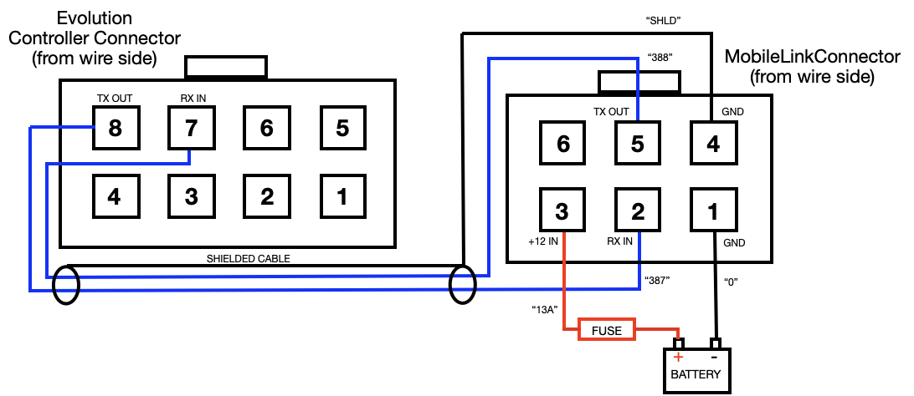
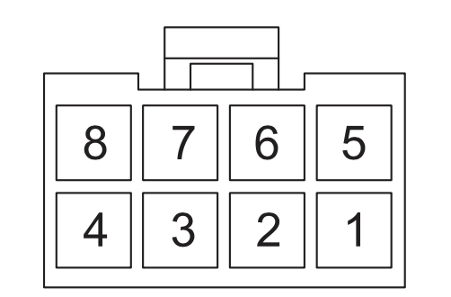
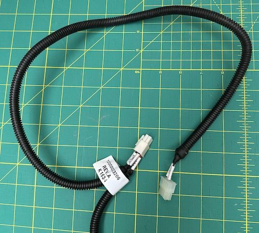
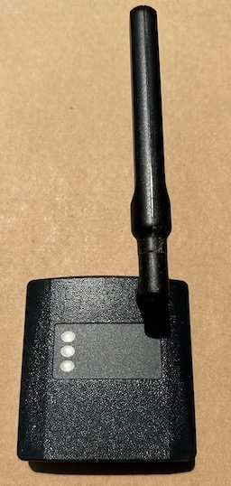
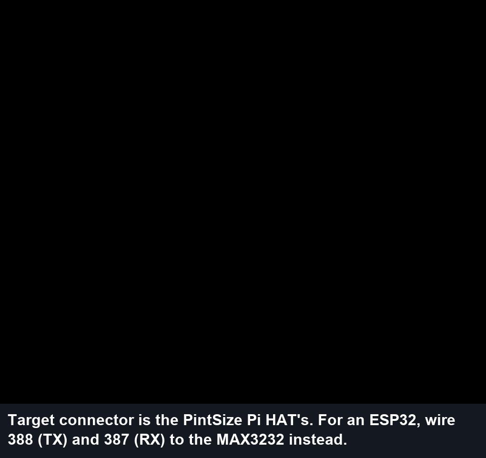
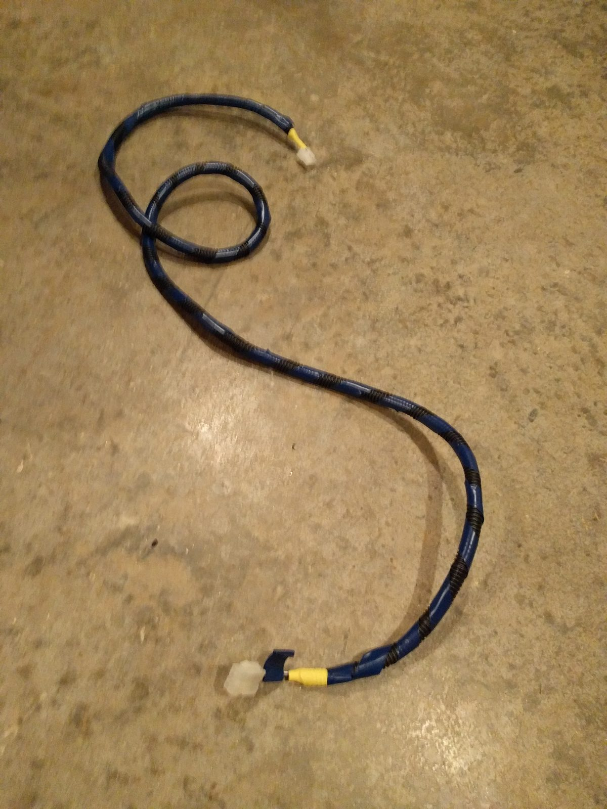
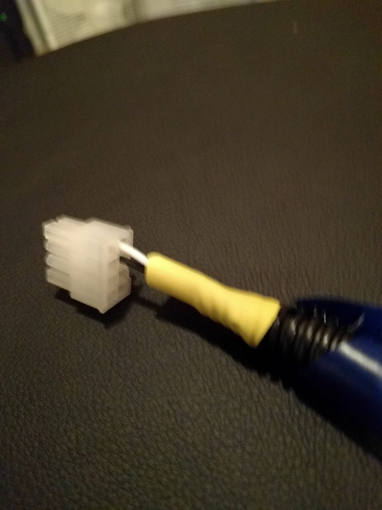
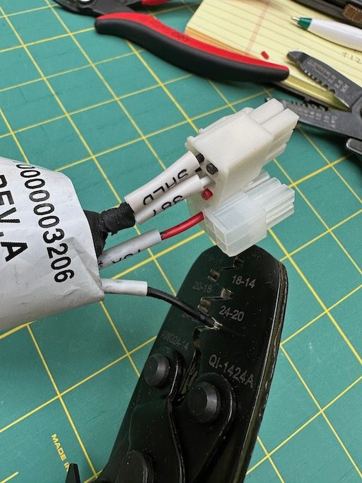
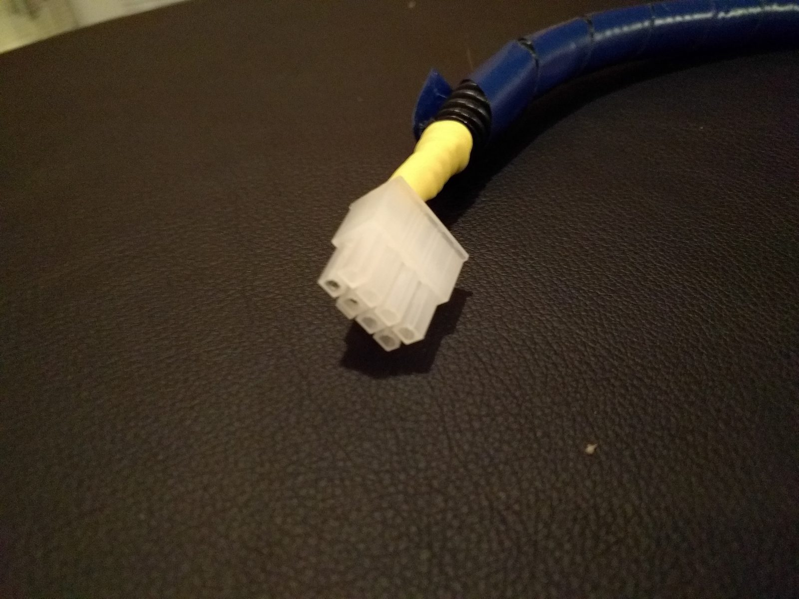

# Cable

The ESP32 build uses exactly the cable a Raspberry Pi genmon install uses: three conductors from
the controller's 8-pin serial connector (TX, RX and a ground reference) to the RS-232 side of the
MAX3232 module. You can reuse Generac's MobileLink harness, or build a cable.

## Controller connector pinout

| Controller pin | Signal | MobileLink harness wire |
|---|---|---|
| **8** | Controller **TX** (data out) → MAX3232 RX (R1IN) | **388** |
| **7** | Controller **RX** (data in) ← MAX3232 TX (T1OUT) | **387** |
| Shield | Ground reference | **SHLD** |

Both drawings above are **from the wire side**. The controller connector carries no ground pin:
the ground reference is the cable shield and the battery negative, which the controller shares.
Your monitor's ground (MAX3232, ESP32, buck converter) must connect to the battery negative or
the shield.

Pin numbering is easy to get backwards because drawings differ in which face they show. Don't rely
on position alone; confirm with a meter (see [wiring](wiring.md#confirm-the-signal-levels)) or by
the 387/388 wire tags.

## The MobileLink harness

If your generator has Generac's MobileLink cellular module, or the harness for it, that harness
already has everything the ESP32 needs:

| MobileLink pin | Wire | Signal | Use for the ESP32 |
|---|---|---|---|
| 5 | 388 | Controller TX | MAX3232 R1IN |
| 2 | 387 | Controller RX | MAX3232 T1OUT |
| 4 | SHLD | Shield / ground | MAX3232 GND |
| 3 | 13A | **+12 V, fused** at the battery | Buck converter IN+ |
| 1 | 0 | Battery ground | Buck converter IN− |

Powering the buck converter from 13A and 0 avoids a separate battery lead and fuse. Disconnect the
MobileLink module itself: it polls the controller over the same serial line, and two pollers on one
port corrupt each other's messages.

Upstream's case study re-pinned the MobileLink plug to fit a Pi Zero HAT. For an ESP32 you can
instead connect the five wires to screw terminals on your board, or fit a matching 2 × 3 Molex
receptacle, so the harness stays reusable.

## Building a cable

| Whole cable | Controller end |
|---|---|
|  |  |

- Use shielded two-conductor cable (for example 22 AWG audio or instrument cable). Connect the
  shield to ground **at the monitor end only**.
- Fit an 8-position (2 × 4) Molex plug that mates with the controller's receptacle, populated at
  pins 7 and 8. Take the controller's connector with you (or a photo of it) when buying housings
  and pins.
- **Liquid-cooled models need a longer cable**, because the controller sits farther from where the
  monitor is mounted. Upstream's liquid-cooled cable was roughly 1.5–2 m.

Next: [wiring](wiring.md).
