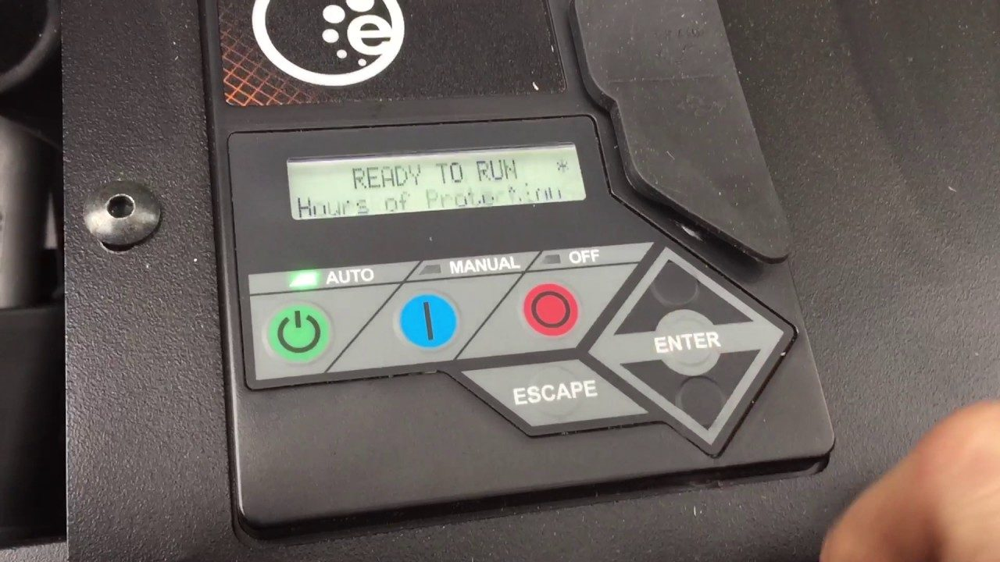
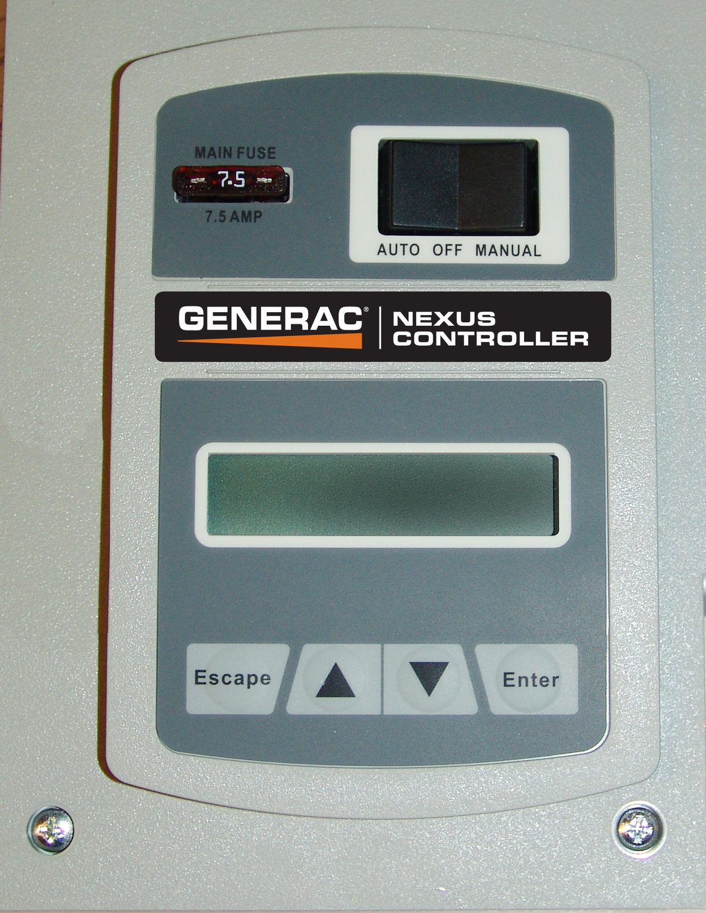
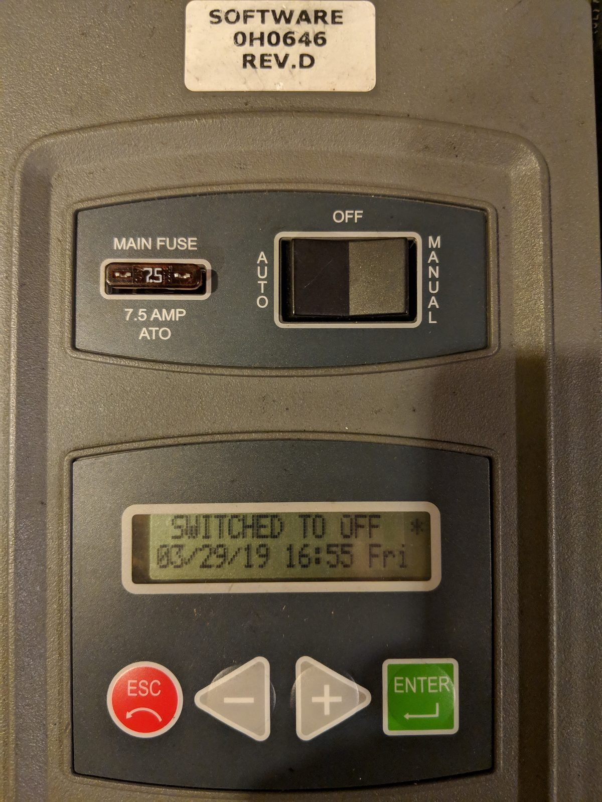
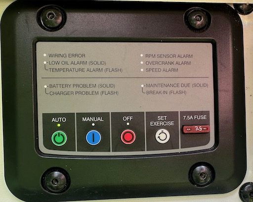
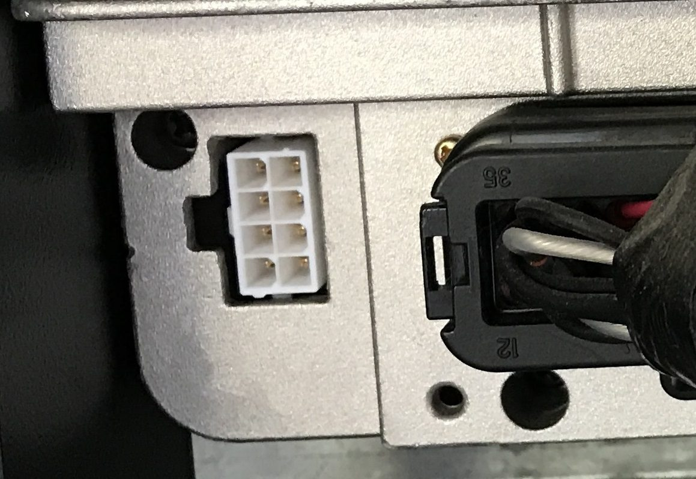
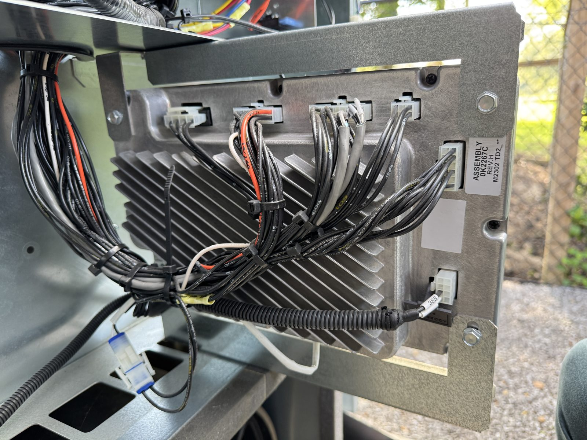
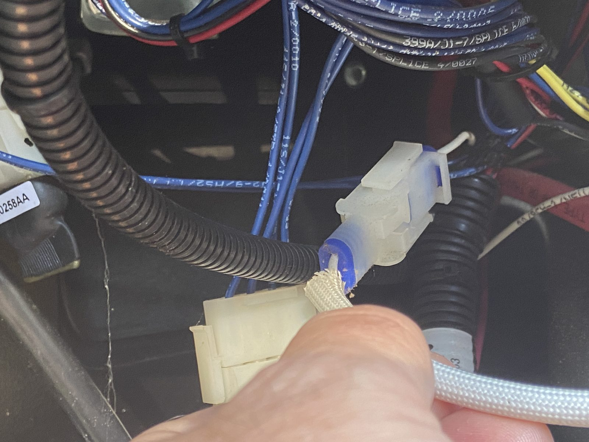

# Controllers

genmon-esp32 talks to the generator through the controller's serial port. This page helps you
identify the controller and find that port. Supported product codes are listed in the
[main README](../README.md#supported-controllers); the firmware also reports the detected
controller on its Maintenance page.

## Identify your controller

| Evolution | Nexus |
|---|---|
|  |  |
| Membrane keypad with AUTO / MANUAL / OFF, ESCAPE and ENTER keys. Evolution 2.0 looks the same; the firmware detects the difference | Rocker switch (AUTO / OFF / MANUAL), 7.5 A main fuse, LCD with Escape / Up / Down / Enter |

| Older and other models | |
|---|---|
|  | **Pre-Nexus (2008 era).** Status is read, but this controller's older log format is not decoded |
|  | **PowerPact.** An Evolution variant with LED indicators instead of an LCD. Supported, without current/power readings (the controller doesn't report them) |

## Find the serial port

The serial port is an **8-pin (2 × 4) Molex connector** on the controller's wiring side. On
generators with Generac's MobileLink option it already has a cable plugged in (see
[cable](cable.md#the-mobilelink-harness)).

| Nexus | Liquid cooled (back of controller) |
|---|---|
|  |  |
| The white 8-pin receptacle beside the main harness connector | The 8-pin connector is at the bottom right; wire tag 388 is the controller's TX |

On air-cooled Evolution units the connector is behind the controller on the wiring side;
upstream's [wiki](https://github.com/jgyates/genmon/wiki) has model-specific photos. Liquid-cooled
models mount the controller farther from where the monitor usually sits and need a longer
cable (see [cable](cable.md)).

## Power the controller down first

Before plugging anything into the controller, put it in **OFF** and disconnect its power. Upstream's
practice is to unplug the controller's 2-pin power connector, shown here, and to remove the
generator's 7.5 A fuse. Reconnect after the monitor is wired, then check the controller's clock
(the monitor can set it: Control → Set generator time).
