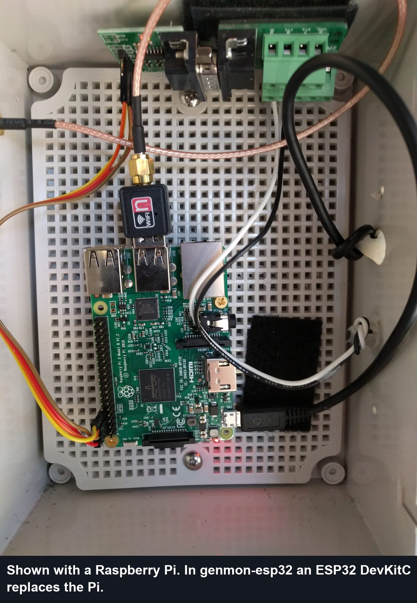
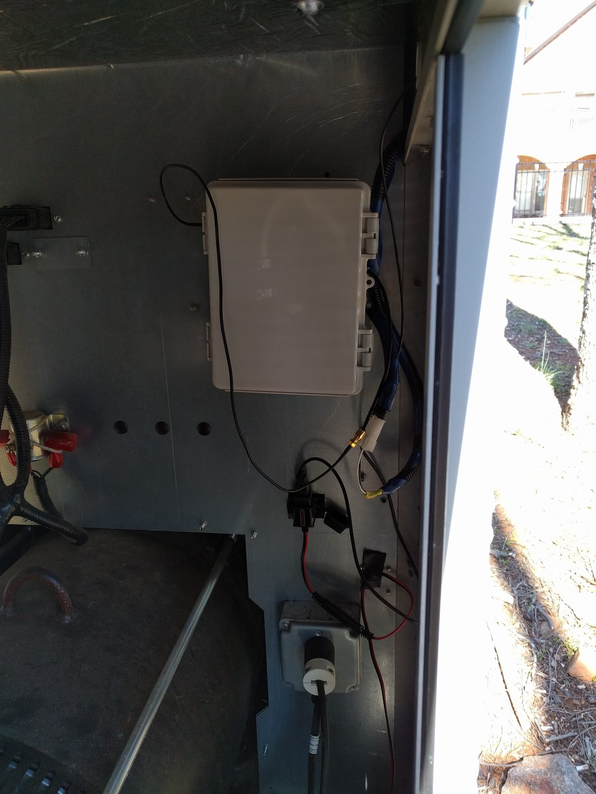
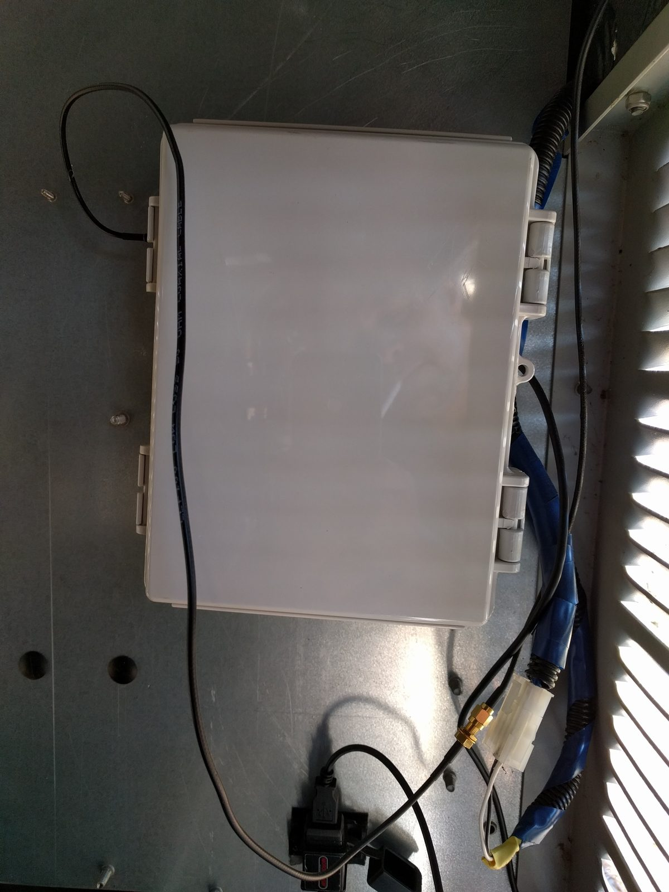
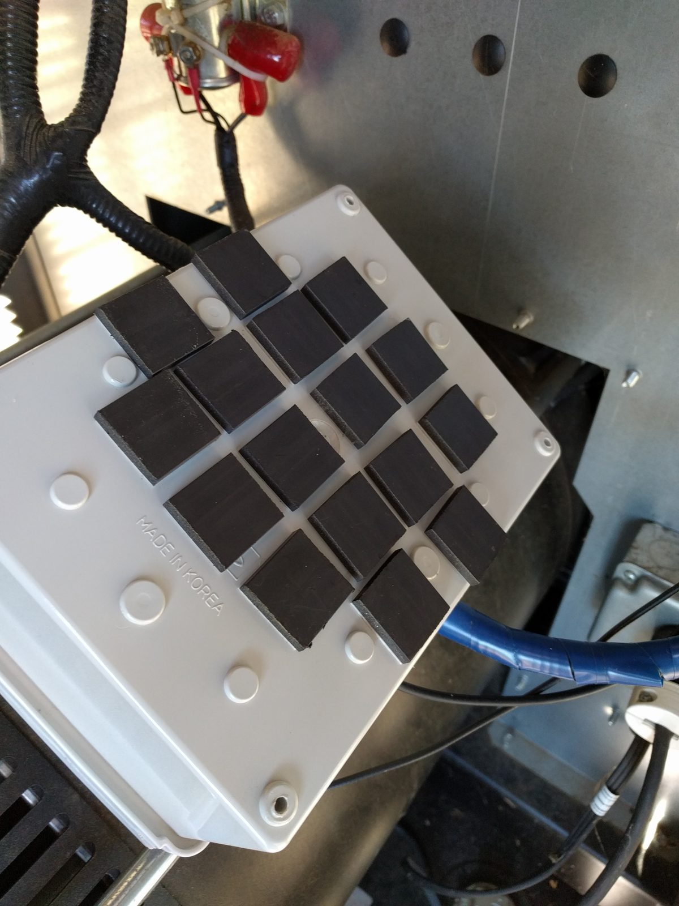
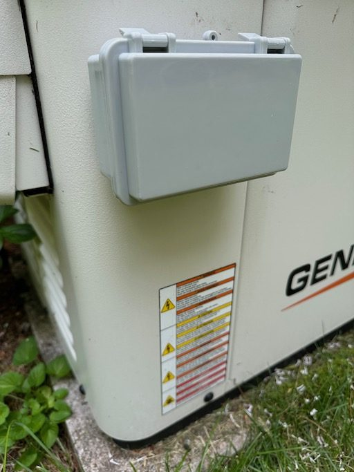
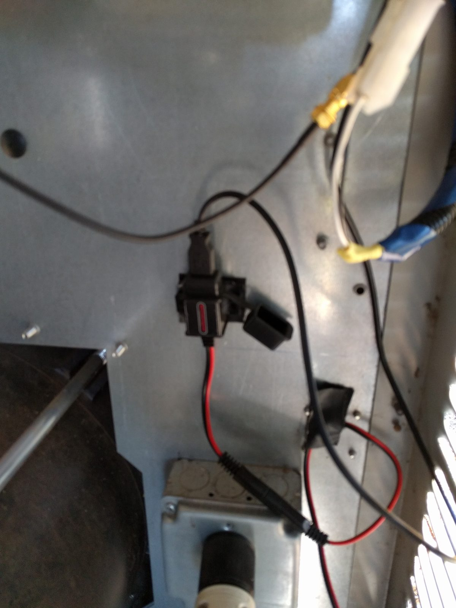
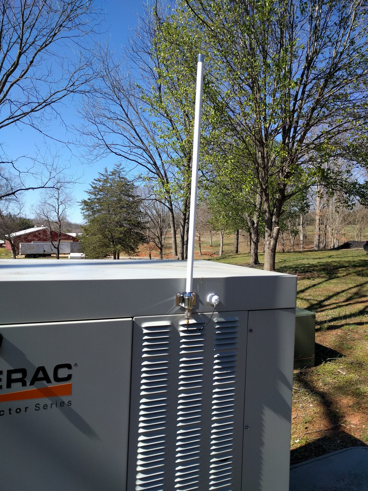
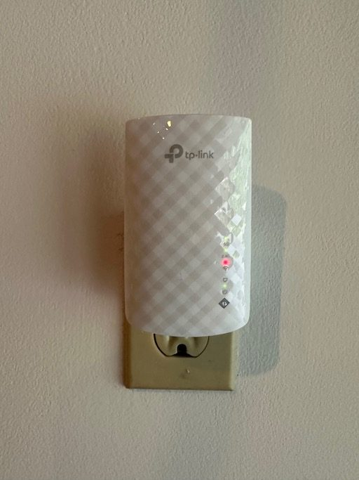

# Enclosure, power and Wi-Fi

The monitor lives inside the generator housing, next to the controller and battery. These are
upstream's installation photos; with genmon-esp32 the box holds an ESP32, a MAX3232 module and a
buck converter instead of a Raspberry Pi, so a smaller box will do.

## Inside the box

- Mount the boards on standoffs or a perforated backplate, or use foam tape, so nothing shorts
  against the box.
- Bring the serial cable and power leads in through grommets or cable glands, and leave a little
  slack and a drip loop.

## Mounting

| Mounted in the generator | Cables and antenna lead |
|---|---|
|  |  |

Flat magnets on the back hold the box to the housing's sheet metal without drilling. Keep the box
away from the exhaust side and moving parts, and route cables away from the engine.

Upstream's Pi Zero case study used a small weatherproof outdoor box on the outside of the
housing, which also helps Wi-Fi.

## Power

Upstream powered the Pi from the starting battery through a fused 12 V → USB socket. For the
ESP32 either option works:

- the **buck converter** wired to the DevKitC's 5V pin (see [wiring](wiring.md)), or
- a **12 V → USB socket** like this one, with a USB cable into the DevKitC.

On generators with a MobileLink harness, its fused 13A wire is the neatest source of +12 V (see
[cable](cable.md#the-mobilelink-harness)). The ESP32 draws far less than a Pi (typically under
200 mA at 5 V), so battery drain is negligible next to the generator's own charger.

## Wi-Fi

The generator housing is a metal box, which weakens Wi-Fi a lot. Check signal strength at the
generator with a phone before building. If it's marginal:

| External antenna | Repeater |
|---|---|
|  |  |
| Use an **ESP32-WROOM-32U** DevKitC (U.FL socket) with a U.FL → SMA pigtail and an outdoor antenna, as upstream did with a USB Wi-Fi adapter. The firmware is the same | Put an access point or repeater near the generator |

The monitor's Monitor page shows the current Wi-Fi signal strength (RSSI); aim for better than
about −75 dBm.
