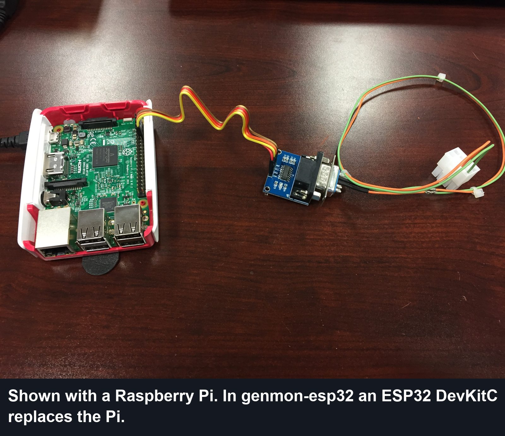
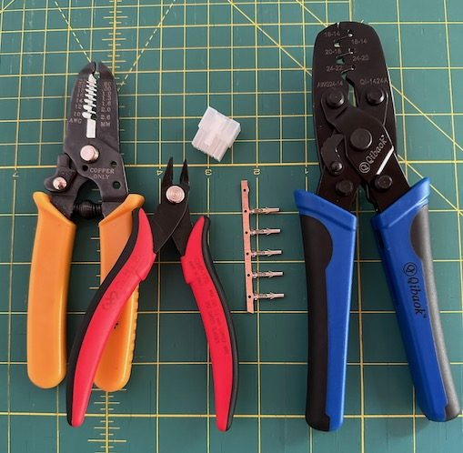

# Hardware

Everything needed to monitor a Generac Evolution or Nexus generator with an ESP32.
Next: [identify your controller](controllers.md), [build the cable](cable.md),
[wire it up](wiring.md), [house it](enclosure.md).

*Upstream genmon's bench build. With genmon-esp32 the ESP32 DevKitC replaces the Pi; the RS-232
module and cable are the same.*

## Parts list

| Part | Notes |
|---|---|
| **ESP32-WROOM-32D DevKitC** | Any ESP32 DevKitC runs the firmware. The **WROOM-32U** variant has a U.FL socket for an external antenna, which helps inside a metal generator housing (see [enclosure](enclosure.md#wi-fi)) |
| **MAX3232 RS-232 ↔ TTL module** | Must be the **3.3 V-capable MAX3232**, not a MAX232. Header or screw-terminal modules are easiest; a DB9 module needs a mating DB9 terminal block (see [wiring](wiring.md#db9-modules)) |
| **12 V → 5 V buck converter, ≥ 1 A** | Wide input (about 8–24 V): the battery reads around 14 V while charging and dips while cranking. A 12 V → USB socket, as in upstream's build, also works when plugged into the DevKitC's USB port |
| **Inline fuse holder and 1 A fuse** | On the battery positive lead, close to the battery. Not needed when powering from the MobileLink harness, whose +12 V wire is already fused (see [cable](cable.md#the-mobilelink-harness)) |
| **Cable to the controller's serial port** | The same cable a Raspberry Pi genmon install uses. See [cable](cable.md) |
| **Hookup wire, ring terminals** | 20–22 AWG for signals and the ~200 mA supply; ring terminals for the battery posts |
| **Weatherproof plastic enclosure** | Plastic so Wi-Fi gets out; standoffs or foam tape inside, grommets or cable glands for the leads |

The ESP32 replaces the Raspberry Pi, its SD card and its USB power supply. Everything else is
shared with upstream's design.

## Optional protection

Cheap insurance on a generator's electrical system:

- **Schottky diode** in series with the buck converter input, in case the battery leads are ever
  reversed (many converters have no reverse-polarity protection).
- **TVS diode** (for example a 24 V unidirectional part) across the converter input, to absorb
  cranking and charging spikes.

## Tools

- Wire stripper and flush cutters
- A ratcheting crimper for Molex pins (upstream used one with AWG 24–14 dies), if you build or re-pin a cable
  (see [cable](cable.md#building-a-cable))
- Multimeter: to confirm the port's signal levels, find TX/RX, and check the 5 V supply before
  the ESP32 is connected
- Soldering iron, unless your modules come with headers and you use Dupont or screw terminals
- A USB data cable for the first flash (micro-USB or USB-C depending on the DevKitC revision);
  later updates are installed over Wi-Fi

## Software side

- [PlatformIO](https://platformio.org/) to build and flash the firmware (see the
  [main README](../README.md#build-and-flash)).
- For Home Assistant: an MQTT broker. The Mosquitto add-on in Home Assistant is the usual choice
  and is what upstream's integration expects too.

Typical cost beyond the ESP32 is about $15–25.
