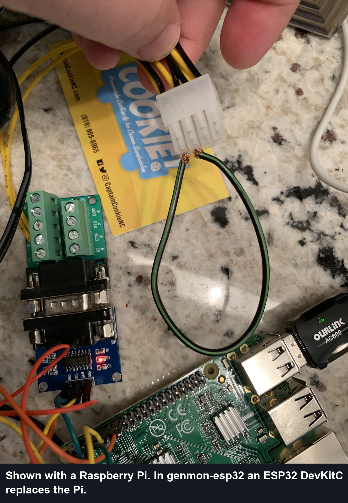

# Troubleshooting

Most problems are wiring or Wi-Fi. The web UI's **Monitor** page shows the counters referred to
below (under *Communication Stats*), recent events, and the raw register values.

## "Not receiving data" / timeouts rising

The ESP32 sends requests but gets no replies.

1. **Swap TX and RX at the ESP32** (GPIO16/GPIO17). Module labels vary; this fixes most new builds.
2. Check that the MAX3232's **VCC is on 3V3** and that all grounds are common, including the cable
   shield or battery negative.
3. Confirm the controller is powered and its 7.5 A fuse is back in.
4. Check the levels with a meter (see [wiring](wiring.md#confirm-the-signal-levels)).
5. Run the loopback test below to tell the cable side from the ESP32 side.

## Loopback test

Upstream tests the serial path by jumpering TX to RX at the far end of the cable:

With genmon-esp32 there's no separate test program. Use the Monitor page instead:

1. Unplug the cable from the controller and jumper its **pin 7 to pin 8** (or, at the module,
   R1IN to T1OUT).
2. Power up and watch *Communication Stats* for a minute:

| Counter that rises | Meaning |
|---|---|
| **CRC Errors** | The loop works: the ESP32 hears its own requests, which fail its frame checks. The ESP32, module and cable are fine, so look at the controller connection |
| **Timeout Errors** | Nothing comes back: the fault is between the ESP32 and the jumper (TX/RX swapped at the ESP32, module power, a broken conductor) |

Remove the jumper and reconnect the controller afterwards.

## Detected the wrong controller

The Maintenance page shows *Controller Detected*. If the product code is unvalidated or wrong,
set `evolutioncontroller` and/or `liquidcooled` in Settings → Controller, as with genmon.

## Garbage or flapping state on Evolution 2.0

Leave `ignore_unknown` on (the default): Evolution 2.0 sometimes returns text fragments in its
status register, and this filters them out. Rising "Modbus Exceptions" on Evolution 2.0 is normal
for a moment while the firmware performs the controller's unlock handshake.

## Current or power reads zero

Current and power need `nominalkw` set (Settings → Generator) and are only reported while the
engine runs. Nexus and PowerPact controllers don't report current. If readings are wrong on an
Evolution, set `currentdivider` / `currentoffset` as you would in genmon.

## Can't reach the web page

- After 30 s without Wi-Fi the setup access point `genmon-setup-XXXX` (password `genmon-setup`)
  opens again; browse to `http://192.168.4.1/`.
- The serial console (115200 baud over USB) prints the device's address at start-up.
- Lost the admin password: factory reset. Press **EN** (reset) and release it, then within 3 seconds
  press and hold **BOOT** for 5 seconds. All settings are erased and the setup access point opens.
  (Holding BOOT *while* pressing EN starts the ESP32's flash loader instead; just reset again.)

## Home Assistant entities missing or duplicated

- Use the same `device_id`, `base_topic` and `discovery_prefix` as your old genmon install, and stop
  the Pi's genmon before the ESP32 connects (see [the main README](../README.md#moving-from-genmon-on-a-raspberry-pi)).
- MQTT discovery must be enabled in Home Assistant's MQTT integration.
- `/api/info` shows whether MQTT is connected and the last connection error.
