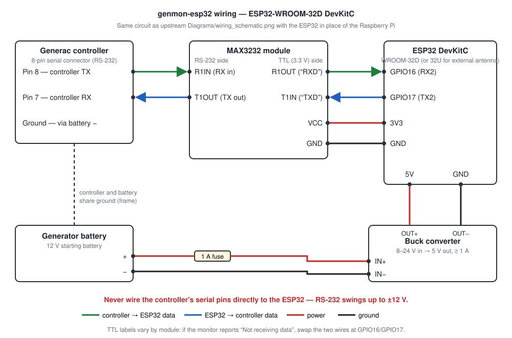
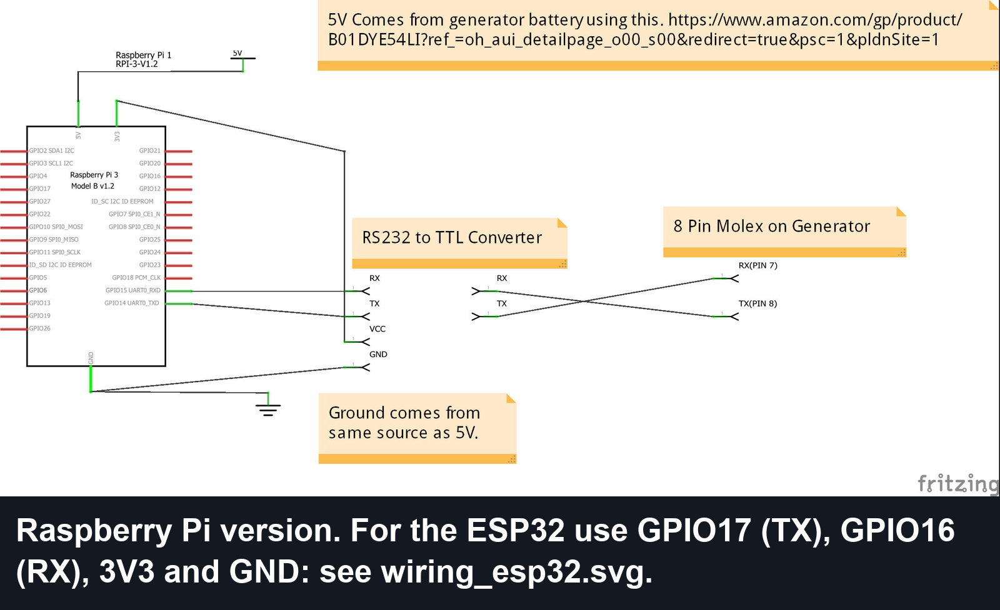
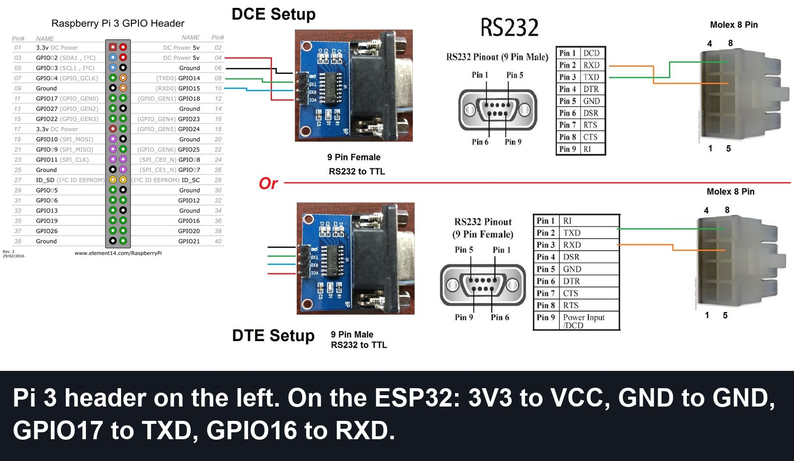

# Wiring

This is upstream genmon's circuit with an ESP32 in place of the Raspberry Pi. Upstream's original
drawings, annotated for the ESP32, are at the end of this page.

## Connections

| From | To | Notes |
|---|---|---|
| Controller pin 8 (TX, wire 388) | MAX3232 **R1IN** (RS-232 RX) | RS-232 is crossed: controller TX → module RX |
| Controller pin 7 (RX, wire 387) | MAX3232 **T1OUT** (RS-232 TX) | |
| Cable shield / battery − | MAX3232 GND | The controller connector has no ground pin (see [cable](cable.md)) |
| MAX3232 **R1OUT** (TTL "RXD") | ESP32 **GPIO16** (RX2) | |
| MAX3232 **T1IN** (TTL "TXD") | ESP32 **GPIO17** (TX2) | |
| MAX3232 **VCC** | ESP32 **3V3** | **Not 5 V.** Upstream powered the module from the Pi's 5 V pin; on the ESP32 that would put 5 V on GPIO16 |
| MAX3232 GND | ESP32 GND | |
| Battery + → **1 A fuse** → buck IN+ | | Skip the fuse when using the MobileLink harness's fused 13A wire |
| Battery − → buck IN− | | |
| Buck OUT+ (5 V) | ESP32 **5V** pin | Set and check 5 V with a meter **before** connecting the ESP32, if the converter is adjustable |
| Buck OUT− | ESP32 GND | |

- All grounds are common: battery −, shield, buck converter, MAX3232, ESP32.
- GPIO16/17 are defaults. Any other usable pins can be set in Settings → Controller
  (`uart_rx_pin`, `uart_tx_pin`).
- TTL pin labels are inconsistent between modules (some label pins from the module's
  point of view, some from the microcontroller's). If the monitor shows "Not receiving data",
  swap the two TTL wires at the ESP32. Swapping is harmless.
- Don't power the DevKitC from USB and its 5V pin at the same time unless your board has a diode
  on 5V. Unplug the buck converter while flashing over USB.

## Confirm the signal levels

Before connecting the ESP32, power the controller and measure the controller's TX (pin 8 / wire
388) against battery negative, with nothing else connected:

| Idle reading | Port type | What to use |
|---|---|---|
| Negative, about −3 to −12 V | RS-232 (expected) | MAX3232 module, as above |
| About +5 V | 5 V TTL | No MAX3232. A 3.3 V ↔ 5 V logic-level shifter (BSS138 type), or a resistor divider (e.g. 10 kΩ / 20 kΩ) on controller TX → GPIO16 |
| About +3.3 V | 3.3 V TTL | Direct: controller TX → GPIO16, controller RX ← GPIO17, common ground |

Upstream's documentation treats these controllers as RS-232, so a negative reading is the likely
result. Never connect RS-232 directly to the ESP32: its pins tolerate 0–3.3 V, while RS-232 swings
to ±12 V.

## DB9 modules

Many MAX3232 modules have a DB9 connector instead of terminals for the RS-232 side. The gender
doesn't matter for this project, because the generator end is a Molex plug, not a DB9. Add a
DB9 screw-terminal block of the opposite gender, then:

| Module DB9 | Typical wiring | Pin 2 | Pin 3 | Pin 5 |
|---|---|---|---|---|
| Female | Modem style (DCE) | Module TX → controller RX (pin 7) | Module RX ← controller TX (pin 8) | GND |
| Male | PC style (DTE) | Module RX ← controller TX (pin 8) | Module TX → controller RX (pin 7) | GND |

Cheap modules don't always follow the convention. Check with a meter: power the module from 3V3
and GND with nothing else attached; the pin idling at about **−5 to −6 V** is the module's TX.

## Upstream drawings (Raspberry Pi)

Upstream's drawings for the Pi build, for reference. The banners describe the ESP32 equivalent.

Next: [enclosure](enclosure.md), then [first-time setup](../README.md#first-time-setup).
